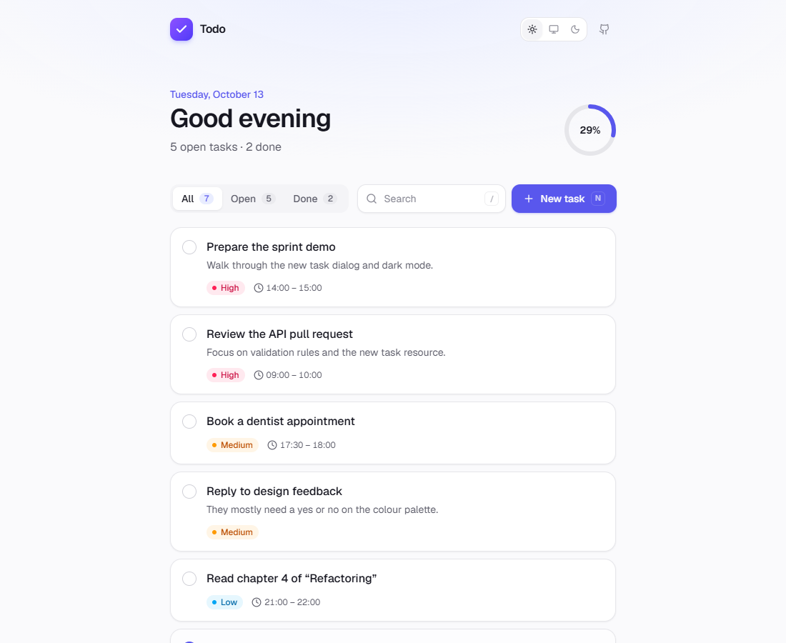
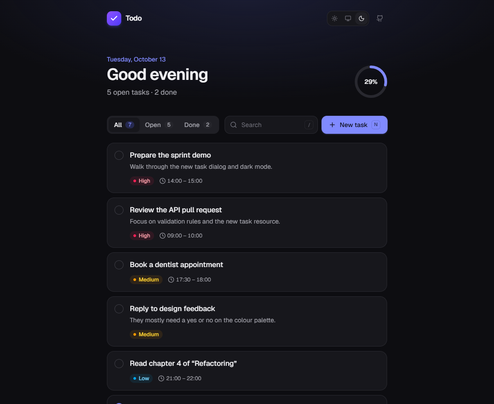
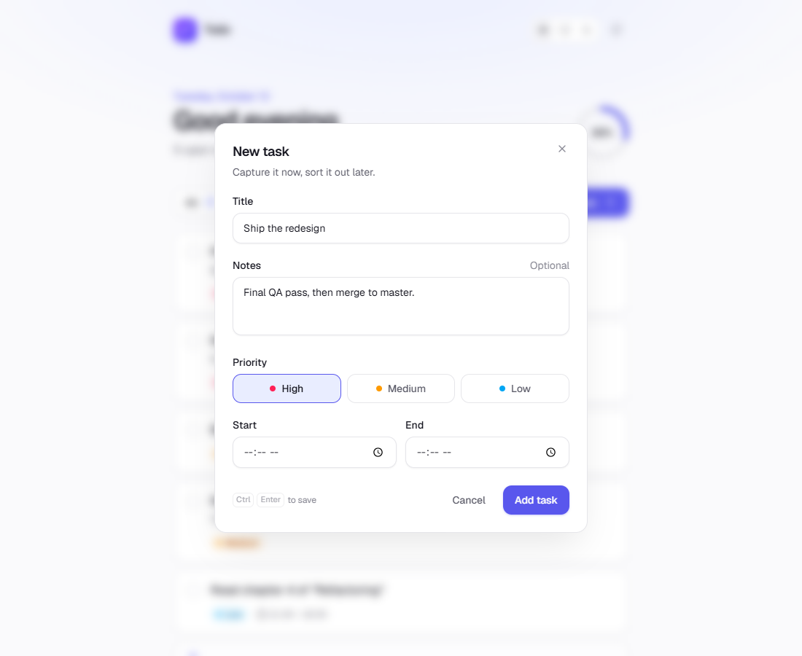
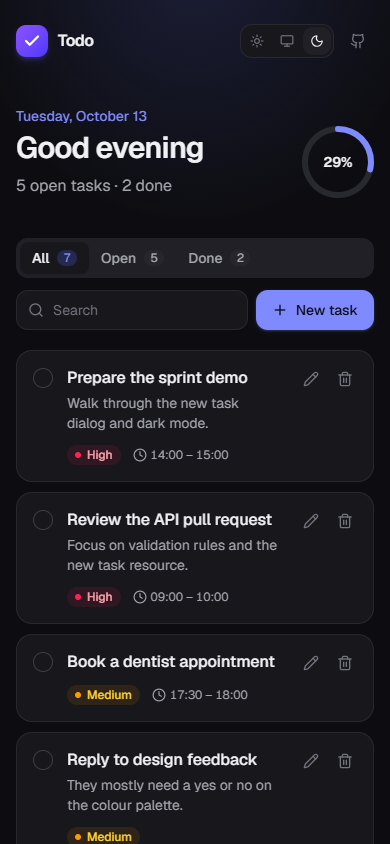

# Todo — Laravel + Vue SPA

[](https://github.com/MohamadTahernezhad/TodoListSpa/actions/workflows/ci.yml)

A calm, focused single-page todo app. The backend is a small, fully tested JSON API built with **Laravel 13**. The frontend is a **Vue 3.5 + TypeScript** SPA styled with **Tailwind CSS 4**.

<p align="center">
  
  
</p>

<p align="center">
  
  
</p>

## Features

- Create, edit, complete and delete tasks, each with a priority and an optional time window
- Filter by status (all / open / done) and search titles and notes instantly
- Optimistic updates with automatic rollback when a request fails
- Daily overview with a progress ring
- Light, dark and system themes, with no flash of the wrong theme on load
- Keyboard shortcuts: <kbd>N</kbd> new task · <kbd>/</kbd> search · <kbd>Ctrl</kbd>+<kbd>Enter</kbd> save · <kbd>Esc</kbd> close
- Accessible: native `<dialog>`, ARIA tabs with arrow-key navigation, labelled controls, visible focus rings and `prefers-reduced-motion` support
- Responsive from 320 px phones to wide desktops

## Tech stack

| Layer    | Tools                                                                       |
| -------- | --------------------------------------------------------------------------- |
| Backend  | PHP 8.3+, Laravel 13, Eloquent, Form Requests, API Resources, backed enums  |
| Frontend | Vue 3.5 (`<script setup>`), TypeScript, Pinia, VueUse, Tailwind CSS 4, Vite |
| Quality  | PHPUnit, Larastan (level 8), Pint, Vitest, Vue Test Utils, ESLint, Prettier |
| CI       | GitHub Actions and Dependabot                                               |

## Getting started

**Requirements:** PHP 8.3+ with `pdo_sqlite`, Composer, Node.js 22+.

```bash
git clone https://github.com/MohamadTahernezhad/TodoListSpa.git
cd TodoListSpa

composer setup          # install deps, create .env + SQLite DB, migrate, build assets
php artisan db:seed     # optional: load a realistic demo day
composer dev            # start the Laravel server and Vite with hot reload
```

The app runs at <http://localhost:8000>. SQLite is the default; to use MySQL or PostgreSQL, set the `DB_*` variables in `.env`.

## Scripts

| Command                         | Description                         |
| ------------------------------- | ----------------------------------- |
| `composer dev`                  | Run the app with hot reload         |
| `composer test`                 | Backend test suite                  |
| `composer lint`                 | Fix PHP code style with Pint        |
| `composer analyse`              | Static analysis with Larastan       |
| `npm test`                      | Frontend test suite                 |
| `npm run test:coverage`         | Frontend tests with coverage report |
| `npm run lint` / `npm run format` | ESLint and Prettier               |
| `npm run typecheck`             | Type-check with `vue-tsc`           |
| `npm run build`                 | Production build                    |

## API

All endpoints live under `/api`, accept and return JSON, and are rate limited to 120 requests per minute per IP.

| Method         | Endpoint          | Description                                   |
| -------------- | ----------------- | --------------------------------------------- |
| `GET`          | `/api/tasks`      | List tasks (open first, then by priority)     |
| `POST`         | `/api/tasks`      | Create a task, returns `201`                  |
| `GET`          | `/api/tasks/{id}` | Show a task                                   |
| `PUT`/`PATCH`  | `/api/tasks/{id}` | Update a task (partial updates supported)     |
| `DELETE`       | `/api/tasks/{id}` | Delete a task, returns `204`                  |

<details>
<summary>Task payload</summary>

```jsonc
{
    "title": "Review the API pull request",   // required, max 120 characters
    "description": "Focus on validation.",    // optional, max 2000 characters
    "priority": "high",                       // "high" | "medium" | "low", default "medium"
    "starts_at": "09:00",                     // optional, HH:MM
    "ends_at": "10:00",                       // optional, HH:MM, must be after starts_at
    "is_completed": true                      // update only
}
```

Invalid input returns `422` with Laravel's standard `{ "message", "errors" }` body.

</details>

## Project structure

```
app/
├── Casts/TimeOfDay.php              # normalises time columns to HH:MM on every database
├── Enums/TaskPriority.php
├── Http/
│   ├── Controllers/Api/TaskController.php
│   ├── Requests/                    # Store/Update requests + shared time-window rule
│   └── Resources/TaskResource.php
└── Models/Task.php

resources/js/
├── api/                             # axios client, error helpers, typed task endpoints
├── components/
│   ├── layout/                      # app header
│   ├── tasks/                       # task list, item, form, filters, overview
│   └── ui/                          # buttons, dialogs, toasts, badges, progress ring
├── composables/                     # toasts, keyboard shortcuts
├── lib/                             # pure helpers (sorting, filtering, dates)
├── pages/TasksPage.vue
├── stores/tasks.ts                  # Pinia store with optimistic updates
└── types/

tests/
├── Feature/                         # API and SPA shell tests
└── Unit/                            # model and enum tests
```

Frontend tests live next to the code they cover (`*.test.ts`).
